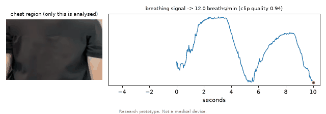

# BreathCam

Camera-based respiratory-rate estimation, evaluated the way a clinical measurement study would be: agreement statistics (Bland-Altman), subject-level validation, a quality gate that refuses to guess, and honest limitations.

> **Research prototype. Not a medical device.** Do not use it to make clinical decisions.



*Chest crop (only this region is analysed, no face) and the breathing signal recovered from video: 12.0 breaths/min on a clip paced at 12.*

## Overview
- **Video pipeline:** video -> chest region (MediaPipe Pose or a manual box) -> optical-flow motion signal -> band-pass -> sliding-window Welch spectrum -> breaths/min plus a quality score. Low-quality windows are rejected.
- **Clinical-signal experiments (BIDMC, 53 ICU patients):** the same estimator scored against manual breath annotations, a 1D CNN trained with patient-level cross-validation, a leakage experiment and a Grad-CAM analysis.
- **Privacy tooling:** face blurring, audio removal and metadata (GPS, device) stripping for video before sharing.
- **Demo app (Streamlit)** and a SQLite-backed evaluation layer.

Status: v1 on one person's clips plus the public BIDMC dataset. See [Limitations](#limitations).

## Install and run
Requires [uv](https://docs.astral.sh/uv/). Python 3.12 is pinned in `.python-version`; every command runs inside the project's virtual environment.

```bash
uv venv --python 3.12 .venv
source .venv/bin/activate
uv pip install -r requirements.txt        # pinned versions (direct deps in requirements.in)
python -m pytest -q                       # about 1.5 min
```

Estimate a rate from a video (chest box in 320-px-wide frame coordinates; the app lets you draw it):

```bash
python -m breathcam.run --video data/raw/clip.mov --roi 115,78,205,135 --plot out.png
streamlit run app.py                      # demo app, everything runs locally
```

Make a shareable copy of a clip (a one-time face-model download is explained by the error message if the model is missing):

```bash
python -m breathcam.deid --video data/raw/clip.mov --out data/deid/clip.mp4 --verify --roi 115,78,205,135
```

Optional: for automatic chest finding download `pose_landmarker_lite.task` into `data/models/` (see the error message from `breathcam/roi.py`).

Reproduce the BIDMC experiments (the dataset is not in the repo):

```bash
python -c "import wfdb; wfdb.dl_database('bidmc','data/bidmc'); wfdb.dl_files('bidmc','data/bidmc',[f'bidmc{i:02d}.breath' for i in range(1,54)])"
jupyter notebook notebooks/01_bidmc_signal.ipynb          # estimator vs annotations
python -m breathcam.bidmc_eval                            # CNN + classical, patient-level CV (about 10 min, CPU)
jupyter notebook notebooks/03_cnn_vs_classical.ipynb
python -m breathcam.leakage                               # leakage experiment (about 10 min)
jupyter notebook notebooks/04_explain_and_leakage.ipynb
```

Evaluate your own clips with SQL:

```bash
python -m breathcam.build_db              # about 90 s; edit CLIPS in breathcam/build_db.py for your files
sqlite3 -header -column data/breathcam.db < sql/eval_queries.sql
jupyter notebook notebooks/02_evaluation.ipynb
```

Seeds are fixed and dependencies pinned, so the numbers below should reproduce.

## Data protocol
**What was collected:** five clips (24-93 s) of the author, seated about 1.5 m from a fixed phone camera at 30 fps, wearing a fitted top: paced at 12 and 20 breaths/min with a metronome, a breath-hold, a hand-wave artifact, and natural breathing. **No other participants and no accelerometer reference.**

**Planned protocol for the next dataset** (not yet done): fixed tripod camera at 30 fps, 1-2 m away; 60-90 s clips; phone accelerometer taped to the chest as an independent reference, synchronised with a clap-and-tap; 3-5 consenting adults (consent form drafted in [`docs/consent_form.md`](docs/consent_form.md)); one factor varied at a time (paced rate, lighting, clothing, distance, camera mount). Participants are stored as pseudonymous codes (S01...); raw video never enters the repository.

Schema and queries: [`sql/schema.sql`](sql/schema.sql), [`sql/eval_queries.sql`](sql/eval_queries.sql). Every reference row records its source (`metronome`, `annotation`, later `accelerometer`) so different kinds of reference are never mixed.

## Results

**Video clips** (one person; reference = metronome *target*, not a measurement; 26 scored windows):

| Method | MAE (breaths/min) | Within +/-2 | Bias | Limits of agreement |
|---|---|---|---|---|
| Frame differencing | 0.11 | 100% | +0.03 | -0.28 to +0.35 |
| Welch on optical flow | 0.12 | 100% | +0.03 | -0.34 to +0.39 |
| Peak detection | 0.18 | 100% | -0.04 | -0.50 to +0.42 |

The quality gate rejected the windows containing the breath-hold and the hand-wave clip. Face blurring did not change the estimate (12.0 vs 12.0 breaths/min).

**BIDMC** (53 patients, 4,809 windows, patient-level cross-validation, 95% CI resamples patients):

| Method | MAE (breaths/min) | 95% CI |
|---|---|---|
| Mean-rate baseline | 2.31 | 1.82 - 2.85 |
| Peak detection | 1.62 | 1.03 - 2.26 |
| Welch | 1.16 | 0.81 - 1.55 |
| 1D CNN | 0.98 | 0.69 - 1.38 |

The CNN's edge over Welch is not statistically distinguishable (paired difference -0.18, 95% CI -0.57 to +0.18). Same CNN with **random-window splits: MAE 0.46**, i.e. leakage halves the apparent error. Full discussion: [`docs/report.md`](docs/report.md).

## Figures
| | |
|---|---|
| [`bidmc_bland_altman.png`](docs/figures/bidmc_bland_altman.png) | Estimator vs annotations, Bland-Altman |
| [`bland_altman_video_vs_metronome.png`](docs/figures/bland_altman_video_vs_metronome.png) | Video methods vs metronome target |
| [`failure_worst_windows.png`](docs/figures/failure_worst_windows.png) | Largest-error windows of the video clips |
| [`bidmc_cnn_vs_welch.png`](docs/figures/bidmc_cnn_vs_welch.png) | CNN vs Welch: scatter and per-patient errors |
| [`leakage_random_vs_patient.png`](docs/figures/leakage_random_vs_patient.png) | Random vs patient-level split, same CNN |
| [`gradcam_1d_examples.png`](docs/figures/gradcam_1d_examples.png) | 1D Grad-CAM examples |

## Limitations
- Healthy adult volunteer (n = 1) and adult ICU patients; **no children and no pediatric performance claims.**
- Small sample, one camera type, one setup, controlled conditions; per-condition analysis is empty and confidence intervals by subject are not estimable for the video data.
- Video results are agreement with a metronome target, not validation against an independent measurement.
- Paced and resting breathing only; this does not detect asthma, wheeze, or retractions.
- The CNN is trained on a clinical respiration signal, not video; one architecture, one seed; it regresses towards the mean at slow and fast rates.
- Research prototype, not a medical device.

## Ethics
No ethics board reviewed this project; the only person recorded is the author; no video has left the author's computer; faces are blurred, audio dropped and metadata stripped before any sharing. Details, including what was *not* done: [`docs/ethics_statement.md`](docs/ethics_statement.md). TCPS 2 CORE-2022 completed (certificate kept locally).

## Future work
- Record a varied dataset with an independent accelerometer reference and several consenting participants; re-run Phases 3-4 with real per-condition tables and subject-level confidence intervals.
- Train and explain a video model (pretrained 3D CNN, temporal Grad-CAM, chest-versus-background occlusion) once there are enough subjects.
- A confidence output for the learned model; live webcam mode in the app.
- Evaluate in conditions closer to the paediatric target.

## Repository
```
breathcam/   signal.py eval.py roi.py motion.py run.py deid.py demo_gif.py db.py build_db.py
             dataset.py models.py train.py explain.py bidmc_eval.py leakage.py
sql/         schema.sql, eval_queries.sql
notebooks/   01 signal, 02 evaluation, 03 CNN vs classical, 04 explain + leakage
tests/       unit tests (synthetic signals, synthetic video, database, models, de-id, app)
docs/        report, related work, glossary, references, ethics statement, consent form, figures
app.py       Streamlit demo
```
Background reading: [`docs/related_work.md`](docs/related_work.md), [`docs/glossary.md`](docs/glossary.md), [`docs/references.md`](docs/references.md). The original project plan is in [`breathcam-plan.md`](breathcam-plan.md).
